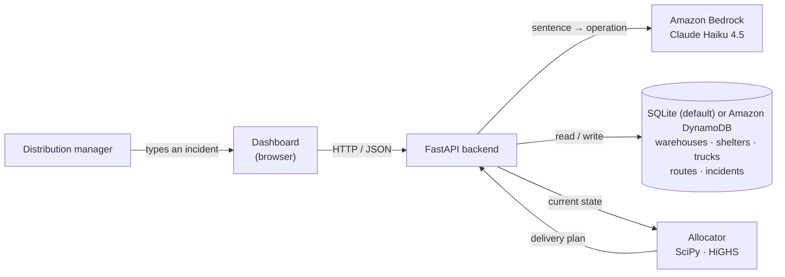

# CrisisOps

AI-assisted food distribution for disaster response. A manager reports what went wrong in plain English. Amazon Bedrock turns it into a structured update, and an optimizer re-plans deliveries so no shelter is left with nothing.

Built at SpartHill Hacks 2026 (AWS track) with Kiro.

## Who it's for

**A food distribution manager** at a county emergency operations center during a disaster. They move food kits from warehouses to shelters with a small fleet of trucks.

**The problem:** the plan breaks all the time. A warehouse loses power, a road floods, a truck breaks down, a shelter fills up. Each change needs a new plan, fast. The usual quick fix (most urgent shelter first, from the nearest warehouse) can leave some shelters with nothing.

## How it works

1. **Report.** The manager types what happened: *"Warehouse B lost power and stopped shipping."*
2. **Understand.** Bedrock turns the sentence into an operation: `{"action": "warehouse_offline", "warehouse": "B"}`.
3. **Review.** The dashboard shows the operation and its impact before anything is saved: kits delivered 880 → 620, worst-off shelter 97% → 66%.
4. **Confirm.** The database is updated, the incident is logged, and a new delivery plan is returned.



### Where Bedrock does the work

- Uses the Bedrock **Converse API with a tool definition**, so Claude must return fields that match a schema: an action, plus a warehouse, shelter, truck, or quantity as needed. Pydantic validates the result.
- Understands **10 actions**: stock added, lost, or set; warehouse offline or online; shelter demand changed; truck offline or online; road closed or reopened.
- **Doesn't guess.** If a detail is missing ("Warehouse A lost some kits"), it asks for it. If the text isn't an incident ("hello"), the manager is told so. Nothing is saved in either case.
- Names the manager uses ("Warehouse B", "Shelter 3") are matched to database IDs (`W2`, `S3`) by lookup, so new warehouses and shelters need no code changes.

### How the plan is computed

- **Inputs:** stock at working warehouses, working trucks, open roads, and each shelter's need.
- **Trucks repeat round trips** within a 6-hour window. A round trip takes 2 × distance ÷ 35 km/h, plus 0.5 h to load.
- **Goal: fairness first.** Raise the worst-off shelter's share of its need as high as possible, then the next one, and so on. Then deliver the most kits with the fewest truck-hours.
- **Two steps:** linear programs find fair targets, then one integer program turns them into whole truck trips. Solved with SciPy's HiGHS in about 0.1–1 s. If the solver fails, the app falls back to the greedy plan.

**Bay County demo** (fictional: 4 warehouses, 10 shelters, 8 trucks, 7 scripted incidents):

| After | Greedy (urgent first, nearest warehouse) | CrisisOps |
|---|---|---|
| Normal operations | 860 kits, worst shelter gets 57% | 880 kits, worst shelter gets 97% |
| Warehouse B loses power | 550 kits, **4 shelters get nothing** | 620 kits, worst shelter gets 66% |
| All 7 incidents | 645 kits, **2 shelters get nothing** | 785 kits, worst shelter gets 74% |

Reproduce with `.venv/bin/python -m optimization.scenario`.

## Run it

Needs Python 3.10+ and AWS credentials (AWS CLI) with access to Claude Haiku 4.5 on Bedrock.

```bash
python -m venv .venv && .venv/bin/pip install -r requirements.txt
cp .env.example .env                  # set AWS_REGION and BEDROCK_MODEL_ID
.venv/bin/python init_db.py reset     # load the Bay County demo (run again to reset after a demo)

python3 frontend/app.py                                   # dashboard → http://127.0.0.1:8000
.venv/bin/uvicorn backend.api:app --port 8001 --reload    # API       → http://127.0.0.1:8001/docs
```

**Use Amazon DynamoDB instead of SQLite:** add `DATABASE_BACKEND=dynamodb` to `.env`, then run `.venv/bin/python init_db.py reset` (creates the `crisisops` table if missing and loads the demo). Every request then uses DynamoDB only. If credentials or the table are missing, the API reports an error and never falls back to SQLite.

Tests: `.venv/bin/python -m pytest -q` (126 tests; Bedrock and DynamoDB are mocked, no AWS needed).

## API

| Endpoint | Purpose |
|---|---|
| `POST /incidents/parse` | Sentence → operation (Bedrock). Nothing saved. |
| `POST /plan/preview` | Before vs after for an operation. Nothing saved. |
| `POST /incidents/apply` | Save the operation, log the incident, return the new plan. |
| `GET /state` | Warehouses, shelters, trucks, roads, totals, last update. |
| `GET /plan?method=optimal\|greedy\|compare` | Current delivery plan and shelter shortages. |
| `GET /incidents/actions` | Example request for every action. |
| `GET /health` | Liveness check. |

## Project layout

```
ai/incident_parser.py       Bedrock call, tool schema, validation
backend/api.py              parse / apply endpoints, CORS
backend/display_api.py      state / plan / preview endpoints
backend/schema.sql          5 tables with foreign keys and no-negative-stock checks
backend/dynamodb_store.py   DynamoDB version of the same data and writes
init_db.py                  build or reset the database, apply operations, match names to IDs
optimization/allocator.py   fairness-first optimizer and greedy baseline
data/demo_scenario.json     Bay County demo data and scripted incidents
frontend/app.py             dashboard
```

Settings live in `.env` (see `.env.example`): Bedrock model and region, default planner, planning window, truck speed, and solver time limits.

## Limits

- The road network is simulated: distance is 1.3 × the straight line. No traffic or live road data.
- One shelter per trip, and trucks return to their home warehouse.
- Shelter priority is used by the greedy baseline only. App weighs every shelter's unmet share equally.
